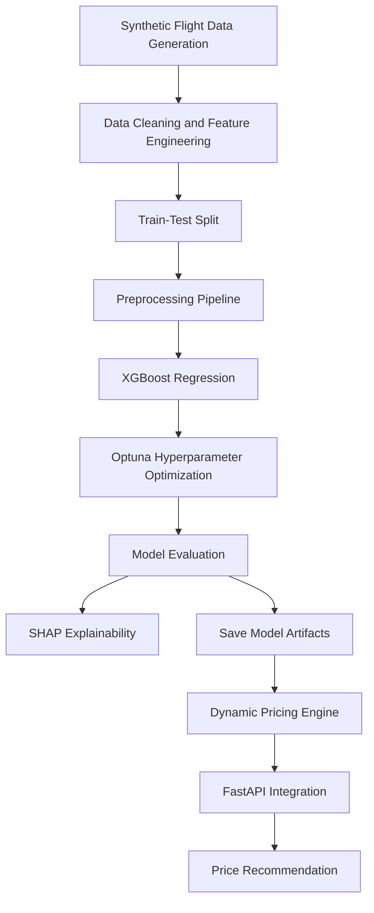

# ✈️ Airline Dynamic Pricing Model Using Machine Learning

An AI-powered airline ticket pricing system that estimates flight ticket prices using demand-related features, seat availability, booking lead time, competitor pricing, fuel costs, weather conditions, and destination events. The project integrates XGBoost regression, Optuna hyperparameter optimization, SHAP explainability, and FastAPI to demonstrate an end-to-end machine learning pricing pipeline.


## 📌 Project Overview

Airline ticket prices fluctuate according to booking time, seat availability, demand patterns, competition, and operating conditions. This project develops a machine learning-based pricing prototype that estimates ticket prices from flight-related features and applies business rules to generate price recommendations.

The system generates synthetic flight data, performs feature engineering, preprocesses numerical and categorical variables, trains an XGBoost regression model, and optimizes hyperparameters using Optuna. SHAP is included to interpret model predictions, while a dedicated pricing engine applies price boundaries and competitor-based adjustments.

The project also defines a FastAPI application to expose the prediction workflow through HTTP endpoints.

## 🎯 Project Objectives

- Generate synthetic airline flight data with operational and market-related features.
- Analyze the relationship between flight characteristics and ticket prices.
- Engineer predictive features related to demand, seat availability, and booking time.
- Build a reusable preprocessing pipeline for machine learning.
- Train an XGBoost regression model for ticket price estimation.
- Optimize model hyperparameters using Optuna.
- Evaluate predictions using MAE, RMSE, and R².
- Interpret model behavior using SHAP explainability.
- Implement pricing constraints and competitor-price adjustment rules.
- Develop REST API endpoints for price prediction and model information.

## 📊 Dataset Description

**Dataset type:** Synthetically generated flight data

**Dataset size:** 5,000 records in the notebook's main execution

**Prediction task:** Regression

**Target variable:** `price`

The dataset is generated programmatically using Python, Pandas, and NumPy. It simulates flight characteristics and pricing-related variables instead of relying on historical airline ticket transactions.

### Features Used

| Feature | Description |
|---|---|
| `flight_id` | Identifier for a generated flight record |
| `departure_city` | Origin city of the flight |
| `arrival_city` | Destination city |
| `aircraft_type` | Aircraft category |
| `seats_remaining` | Number of available seats |
| `days_to_departure` | Days remaining before departure |
| `is_weekend` | Weekend indicator |
| `is_holiday` | Holiday indicator |
| `time_of_day` | Departure time category |
| `month` | Month category |
| `day_of_week` | Day of the week |
| `base_demand` | Simulated demand level |
| `route_popularity` | Simulated route popularity |
| `competitor_price` | Simulated competitor fare |
| `fuel_price` | Generated fuel-price input |
| `weather_conditions` | Simulated weather category |
| `events_count` | Number of destination events |
| `price` | Synthetic ticket price to be predicted |

### Data Generation

The notebook generates flight scenarios using predefined origin and destination cities, aircraft categories, remaining seat capacity, booking lead time, weekend and holiday indicators, and additional simulated market signals.

The synthetic price is calculated using a predefined formula that combines multiple factors, pricing adjustments, and random noise.

**Data limitation:** The dataset does not represent verified historical airline prices. Competitor pricing, fuel prices, weather, and destination events are simulated by the current implementation.

## ⚙️ Project Workflow



## 🔍 Exploratory Analysis and Feature Engineering

The project creates additional features to represent relationships between seat availability, demand, booking time, and destination events.

| Engineered Feature | Purpose |
|---|---|
| `seats_to_demand_ratio` | Relates remaining seats to simulated demand and route popularity |
| `price_competitiveness` | Intended to represent competitor-price relationships |
| `time_sensitivity` | Applies a logarithmic transformation to days until departure |
| `premium_factor` | Combines weekend and holiday indicators |
| `events_impact` | Applies a logarithmic transformation to destination event count |

These features help demonstrate how raw flight attributes can be transformed into inputs for a regression model.

## 🛠️ Data Preprocessing

The notebook uses Scikit-learn's `ColumnTransformer` and preprocessing pipelines.

- **Numerical preprocessing:** Custom logarithmic transformation and standard scaling.
- **Categorical preprocessing:** One-hot encoding with unknown-category handling.
- **Feature separation:** Numerical and categorical features are processed separately.
- **Train-test split:** 80% training data and 20% test data, using `random_state=42`.
- **Preprocessor reuse:** The fitted transformation pipeline is reused when preparing test data and inference inputs.

The preprocessing pipeline provides a structured way to transform different feature types before model training.

## 🤖 Machine Learning Model

### XGBoost Regression

The project uses `XGBRegressor` to predict continuous ticket prices.

XGBoost is a gradient-boosting algorithm that combines decision trees to learn patterns and nonlinear relationships in structured data.

The model uses generated flight attributes and engineered features to estimate the synthetic ticket price.

### Hyperparameter Optimization with Optuna

Optuna searches for a model configuration that minimizes mean absolute error (MAE).

The search includes the following hyperparameters:

- `n_estimators`
- `max_depth`
- `learning_rate`
- `subsample`
- `colsample_bytree`
- `gamma`
- `reg_alpha`
- `reg_lambda`

The notebook runs 30 optimization trials and trains a final model using the selected configuration.

**Evaluation note:** The current notebook uses test-set error during tuning and early stopping. A separate validation set or cross-validation should be used for model selection before reporting final test performance.

## 📈 Model Evaluation

The notebook calculates several regression metrics to evaluate the model.

| Metric | Description |
|---|---|
| MAE | Mean Absolute Error; average absolute difference between actual and predicted prices |
| RMSE | Root Mean Squared Error; penalizes larger prediction errors more heavily |
| R² Score | Measures the proportion of target variance explained by the model |
| Mean Actual Price | Average actual synthetic ticket price |
| Mean Predicted Price | Average predicted ticket price |
| Relative Error | Prediction error relative to the average actual price |

The metrics are generated during notebook execution. The current project materials do not establish a verified final evaluation result that should be presented as a benchmark.

The MAE and R² values shown by the API's model-information endpoint are hard-coded example values and must not be interpreted as measured model performance.

## 🔎 Model Explainability with SHAP

The project includes SHAP-based explainability to investigate how individual input features contribute to XGBoost predictions.

The explanation workflow:

1. Selects a sample of training records.
2. Transforms the records using the fitted preprocessing pipeline.
3. Retrieves transformed feature names.
4. Calculates SHAP values.
5. Generates a summary visualization.

SHAP helps inspect the behavior of the trained model and identify which features influence its predictions.

Because the model uses synthetic data, the explanations describe patterns learned from the generated dataset rather than validated airline-market relationships.

## 💰 Dynamic Pricing Engine

The `AirlinePricingEngine` class combines the regression model with business rules for price recommendations.

### Pricing Workflow

1. Validate the incoming flight record.
2. Apply the fitted preprocessing pipeline.
3. Generate the base ticket-price prediction.
4. Calculate minimum and maximum price bounds.
5. Compare the prediction with the competitor price.
6. Apply competitor-based pricing adjustments.
7. Enforce the absolute price floor and ceiling.
8. Return the final price recommendation and supporting information.

### Pricing Constraints

The notebook defines the following price boundaries:

```python
min_price = max(100, 0.7 * predicted_price)
max_price = min(5000, 1.3 * predicted_price)
```

The absolute minimum price is $100, and the absolute maximum price is $5,000.

The pricing engine also implements rules that adjust the predicted price according to the supplied competitor fare.

These rules demonstrate the integration of machine learning predictions with a business logic layer. They do not establish that the resulting prices maximize airline revenue or profit.

## 🧪 Sample Flight Scenario

The notebook defines a sample flight with the following inputs:

| Parameter | Example Value |
|---|---|
| Departure City | New York |
| Arrival City | London |
| Aircraft Type | Boeing 787 |
| Seats Remaining | 45 |
| Days to Departure | 7 |
| Weekend | Yes |
| Holiday | No |
| Time of Day | Evening |
| Month | July |
| Competitor Price | $1,200 |
| Base Demand | 2.1 |
| Fuel Price | $3.80 |
| Route Popularity | 1.4 |
| Weather | Clear |
| Event Count | 3 |

The notebook passes this record through feature engineering, preprocessing, price prediction, and the pricing engine.

The final numerical output should be obtained by running the notebook; no unverified predicted price is claimed here.

## 🚀 FastAPI Integration

The notebook defines a FastAPI application called **Airline Dynamic Pricing API**, version `1.0`.

| Endpoint | Method | Purpose |
|---|---|---|
| `/predict` | POST | Accepts flight details and returns a price recommendation |
| `/health` | GET | Returns service-health information |
| `/model_info` | GET | Returns model metadata and feature information |

Pydantic is used to define request fields, while Uvicorn is configured as the application server.

When the application is running locally, interactive API documentation is available at:

```text
http://127.0.0.1:8000/docs
```

The notebook defines the API endpoints, but the API must be placed in an importable Python module and supplied with the required model artifacts before it can be started using a conventional Uvicorn command.

## 💾 Model Persistence

The notebook saves versioned model artifacts using Joblib:

```text
model_artifacts/
├── pricing_model_v1.0.pkl
├── preprocessor_v1.0.pkl
└── pricing_engine_v1.0.pkl
```

These files allow the trained model and preprocessing components to be reused without repeating the entire training process.

The artifacts are generated when the relevant notebook cells run. They are not automatically available simply because the notebook is uploaded to GitHub.

## 💻 Technologies Used

| Technology | Purpose |
|---|---|
| Python | Core programming language |
| Pandas | Data manipulation |
| NumPy | Numerical operations and data generation |
| Scikit-learn | Preprocessing and evaluation |
| XGBoost | Regression model |
| Optuna | Hyperparameter optimization |
| SHAP | Model explainability |
| Matplotlib | Data visualization |
| Seaborn | Statistical visualization |
| Joblib | Model serialization |
| FastAPI | REST API framework |
| Pydantic | Request validation |
| Uvicorn | API server |
| Jupyter Notebook | Model development and experimentation |


## ⚙️ Installation and Usage

### 1. Clone the Repository

```bash
git clone https://github.com/YOUR-USERNAME/airline-dynamic-pricing-model.git
cd airline-dynamic-pricing-model
```

Replace `YOUR-USERNAME` with your GitHub username.

### 2. Create a Virtual Environment

```bash
python -m venv venv
```

Activate the environment.

**Windows**

```bash
venv\Scripts\activate
```

**macOS / Linux**

```bash
source venv/bin/activate
```

### 3. Install Dependencies

```bash
pip install -r requirements.txt
```

The `requirements.txt` file should contain the packages imported by the notebook, with compatible versions tested in your environment.

### 4. Run the Notebook

```bash
jupyter notebook
```

Open:

```text
notebooks/Dynamic_Pricing_Model_Airlines.ipynb
```

Run the cells in order to generate synthetic data, train the model, evaluate predictions, explore SHAP explanations, and create model artifacts.

**Note:** Review the notebook's file paths before running it locally, especially paths for saving model artifacts and output files.

## 🔮 Future Improvements

- Correct target leakage in `price_competitiveness`.
- Use consistent feature engineering during training and inference.
- Introduce a validation set or cross-validation for hyperparameter tuning.
- Replace synthetic pricing data with suitable historical flight-fare data.
- Integrate supported APIs for live competitor prices, fuel costs, weather, and destination events.
- Develop demand forecasting and price-elasticity analysis.
- Evaluate pricing strategies using clearly defined revenue and profit objectives.
- Replace hard-coded API metrics with verified evaluation results.
- Add automated tests for preprocessing, prediction, and API endpoints.
- Implement model monitoring, reproducible environments, and deployment configuration.
- Build a dashboard for interactive flight-price analysis.

## ⚠️ Limitations

- The model is trained on synthetic rather than historical airline pricing data.
- External market signals are simulated rather than retrieved from live providers.
- The current feature engineering includes target leakage and a training/inference mismatch that require correction.
- Test-set reuse during optimization can make reported evaluation results optimistic.
- Pricing adjustments use predefined business rules rather than a validated revenue optimization strategy.
- API performance metrics include hard-coded example values.
- The notebook does not establish a successful public production deployment.

## 📄 Project Report

The repository includes the accompanying project report, **Dynamic Pricing Model for Airlines**.

The report describes a simplified Linear Regression model trained on 500 synthetic records using three features: days until departure, seats remaining, and weekend status. The current notebook implements a more advanced XGBoost-based version with additional features, Optuna optimization, SHAP explainability, and FastAPI integration.

The report and notebook therefore represent different implementations and should not be described as identical versions of the same model.

## 👨‍💻 Author

**Manoj Bhorge**

BBA-CA Graduate | Python | Machine Learning | Data Analysis

GitHub: [manojBhorge07](https://github.com/manojBhorge07)

LinkedIn: [Manoj Bhorge](https://in.linkedin.com/in/manoj-bhorge-630a81287)


**Disclaimer:** This project demonstrates a machine learning-based airline pricing prototype using synthetic data. It is not a validated airline revenue-management system, and its predictions should not be interpreted as actual market fares or guaranteed optimal prices.
